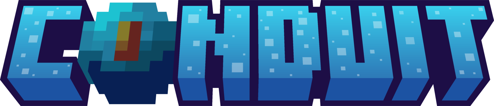

 

### Better tools. Faster development. Less waiting.

**Developer tools for Minecraft: Bedrock Edition, focused on improving the JSON UI development experience.**

---

## About Conduit

**Conduit** is a development project dedicated to creating tools that make working with Minecraft: Bedrock Edition easier, faster, and more efficient.

Our focus is on improving the developer experience by simplifying repetitive workflows, providing useful debugging information, and making it easier to experiment with Minecraft's user interface systems.

Whether you're developing a resource pack, building a custom JSON UI, or debugging complex interfaces, our goal is to help you spend more time creating and less time troubleshooting.

## Our Projects

### Conduit Client

**Our first project — a DLL-based development utility for Minecraft: Bedrock Edition.**

Conduit Client is designed to streamline JSON UI development by providing in-game tools that would otherwise require repetitive manual work.

**Key features:**

- **JSON UI Hot Reloading** — Apply UI changes without restarting Minecraft.
- **Targeted Reloading** — Reload UI definitions without refreshing unrelated game resources in confirmed testing.
- **In-Game Diagnostics** — Inspect screen information, UI elements, and factory statistics.
- **Developer Shortcuts** — Quickly access development functionality through keyboard shortcuts.
- **Debug Logging** — Diagnose reload activity and initialization problems.

Conduit Client is currently in **beta**, with additional improvements and development tools planned.

[**Explore Conduit Client →**](https://github.com/Conduit-BE/client)

---

## Our Vision

We believe developing for Minecraft Bedrock should be an enjoyable and efficient experience.

Conduit aims to provide a collection of practical developer tools that simplify development, improve debugging, and reduce the time spent on repetitive tasks.

Our priorities are:

- **Performance** — Keep development tools responsive and minimize unnecessary operations.
- **Simplicity** — Make advanced functionality accessible through straightforward workflows.
- **Developer Experience** — Build tools around the actual needs of Minecraft developers.
- **Transparency** — Document technical limitations, known issues, and development progress.
- **Community** — Encourage feedback and collaboration to improve our tools.

## Get Involved

Conduit is still growing, and community feedback plays an important role in shaping its development.

You can support the project by reporting bugs, suggesting features, testing releases, or contributing code.

### Join the Community

Connect with other developers, follow development progress, and share your feedback.

[**Discord Server**](https://discord.gg/bestack) · [**GitHub Repositories**](https://github.com/Conduit-BE)

---

**Conduit** — Built for developers, by developers.

Not affiliated with Mojang Studios or Microsoft.

